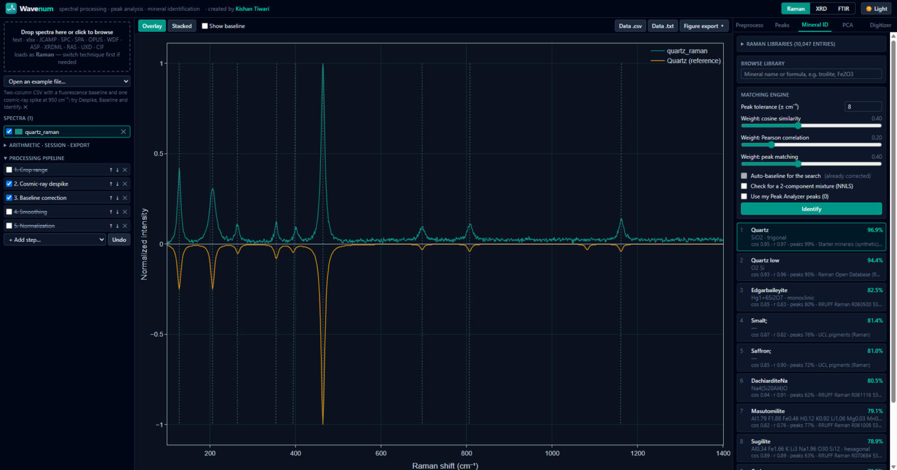

<p align="center">
  
</p>

<h1 align="center">Wavenum</h1>

<p align="center">
  Local-first Raman, FTIR and XRD processing, peak analysis and mineral identification.<br>
  Created by <a href="https://kishangeo.github.io/">Kishan Tiwari</a>
</p>

---

<p align="center">
  
  <br><em>A quartz Raman spectrum after despiking and baseline correction, identified against the libraries (mirror plot: sample above, reference below).</em>
</p>

Wavenum is a browser-based spectroscopy workbench with a small Python backend. It runs entirely on
your own computer: spectra are never uploaded anywhere. It was built for identifying minerals in
meteorites and rocks, and also works for pigments, polymers and other materials covered by the
bundled reference libraries.

## Features

**Data in and out**
- Drag-and-drop loading of text tables (`.txt .csv .xy .dat …`, delimiter and header detection, column picker),
  Excel, JCAMP-DX, Thermo SPC, Nicolet SPA, Bruker OPUS, Agilent ASP, PANalytical XRDML, Rigaku RAS,
  Bruker UXD, Renishaw WDF and CIF (loaded as a computed powder pattern). See [File formats](#file-formats).
- Plot digitizer: extract a spectrum from a PNG/JPG or a PDF page with four-point axis calibration.
- Example files for learning: **Open an example file…** in the sidebar loads Raman, FTIR and XRD examples
  in each common format (CSV, RRUFF text, Excel, JCAMP-DX, `.xy`, XRDML, CIF) plus figures for the digitizer
  (`samples/examples`).
- Export processed data (`.csv`/`.txt`), peak tables, PCA scores, and publication figures
  (SVG or high-DPI PNG with configurable font, labels, ticks and legend).
- Save and reopen a whole workspace as a `.wavenum.json` session.

**Processing** — a non-destructive pipeline per spectrum: every step can be toggled, reordered, undone,
saved as a JSON preset and batch-applied to all spectra.
- Crop, cosmic-ray despiking (Whitaker–Hayes), baseline (ALS, airPLS, iterative polynomial, rubberband,
  with baseline overlay), Savitzky–Golay or moving-average smoothing, normalization (min–max, vector,
  area, SNV), derivatives, unit conversion (transmittance ↔ absorbance, nm → Raman shift), resampling,
  x-axis calibration shift.
- Overlay or stacked views; average spectra; scaled spectral subtraction.

**Peaks**
- Automatic peak finding (prominence, height, distance) plus click-to-add/remove.
- Gaussian, Lorentzian and Voigt fitting with components, residuals and a table of centre, height,
  FWHM, area and R²; XRD d-spacings.
- **Olivine composition** from the ~820/850 cm⁻¹ doublet (Kuebler et al. 2006).
- **Carbonaceous-matter thermometry** from fitted D and G bands (Beyssac et al. 2002; Kouketsu et al. 2014;
  Busemann et al. 2007), with each calibration's fitting protocol shown alongside.

**Identification**
- Library search scored by cosine similarity, Pearson correlation and shift-tolerant peak matching
  (adjustable weights and tolerance), with a mirror plot of sample against reference.
- Automatic baseline correction of the search copy, so raw spectra can be searched directly.
- Two-component mixture check (non-negative least squares on the residual).
- **Cross-technique identification:** load Raman, FTIR and/or XRD data of the same sample and list the
  phases supported by more than one technique.
- Library browser: look up any reference by mineral name or formula and overlay it.
- Import your own folders of RRUFF-style `.txt` spectra as additional libraries.

**Chemometrics** — PCA scores and loadings with optional k-means grouping.

## Installation

Requirements: Python 3.10 or newer, and Node.js 18 or newer (only to build the interface).

```bash
git clone https://github.com/kishangeo/Wavenum.git
cd Wavenum

python -m venv .venv
# Windows:      .venv\Scripts\activate
# macOS/Linux:  source .venv/bin/activate
pip install -r requirements.txt

cd frontend
npm ci
npm run build
cd ..
```

## Running

```bash
python backend/main.py
```

Then open <http://127.0.0.1:8765>. On Windows, `run.bat` starts the server and opens the browser.

## Reference libraries

The repository ships with the libraries whose licences allow redistribution, so identification works
straight after installation:

| Technique | Library | Entries | Licence |
|---|---|---|---|
| Raman | Raman Open Database (ROD) | 1,131 | CC0 |
| Raman | Starter minerals (synthetic profiles at literature peak positions) | 31 | MIT (this project) |
| XRD | COD mineral structures 9000000–9017999 (AMCSD-derived), powder patterns computed for Cu Kα (1.54184 Å) | 14,343 (4,107 minerals) | CC0 |

The full set adds about 10,000 more spectra, including the RRUFF Raman and infrared collections. These
are not redistributed here. Click **Mineral ID → Download & build full libraries** in the app, or run
(about 450 MB; files already downloaded are reused):

```bash
python backend/download_databases.py
python backend/build_library.py
```

| Technique | Library | Entries |
|---|---|---|
| Raman | RRUFF Raman (excellent quality) | 5,185 |
| Raman | RRUFF Raman | 3,087 |
| Raman | CHSOS pigments, UCL pigments, SLoPP/SLoPP-E microplastics, carbohydrates, pharmaceutical excipients | 613 |
| FTIR | RRUFF infrared | 882 |
| FTIR | Kimmel Center, Primpke microplastics, SWGDRUG, PSLC polymers, Archaeometrielabor | 1,546 |

These come from the [Spectragryph database collection](https://www.effemm2.de/spectragryph/down_databases.html)
(RRUFF as a 2017 snapshot), read with a reverse-engineered `.sgdr` reader (`backend/sgd.py`).
Newer RRUFF data can be added with *Mineral ID → Import* pointing at an unzipped RRUFF folder.

Please cite the original data owners when you publish matches: RRUFF (Lafuente et al. 2015),
ROD (El Mendili et al. 2019), COD (Gražulis et al. 2009), AMCSD (Downs & Hall-Wallace 2003), and the
owners listed on the Spectragryph page for the other collections.

## File formats

| Format | Extensions | Tested |
|---|---|---|
| Delimited text, RRUFF text | `.txt .csv .xy .xye .dat .asc .dpt .prn` | yes |
| Excel | `.xlsx .xls` | yes |
| JCAMP-DX | `.jdx .dx .jcm .jcamp` | yes, real file |
| Thermo / Galactic SPC | `.spc` (new format) | yes, real file |
| Nicolet OMNIC | `.spa` | yes, real file |
| Bruker OPUS | `.0 .1 …` | yes, real file |
| Agilent | `.asp` | yes, real file |
| Crystal structure | `.cif` | yes |
| PANalytical | `.xrdml` | synthetic input only |
| Rigaku | `.ras` | synthetic input only |
| Bruker / Siemens | `.uxd` | synthetic input only |
| Renishaw WiRE | `.wdf` | not yet tested |

Files containing several spectra (maps) load the first one. Old-format SPC, Horiba, WITec, Bruker
`.raw/.brml` and PerkinElmer `.sp` are not supported; export those to text or JCAMP-DX.
Sample files and bug reports for any format are welcome.

## Calibrations used

| Calculator | Equation | Source |
|---|---|---|
| Olivine Fo | Eqs. (1)–(3), Table 4 coefficients; ±10 Fo for the two-peak form | Kuebler, Jolliff, Wang & Haskin (2006), *GCA* 70, 6201–6222, [doi:10.1016/j.gca.2006.07.035](https://doi.org/10.1016/j.gca.2006.07.035) |
| CM temperature (R2) | T = −445·R2 + 641; 330–650 °C, ±50 °C | Beyssac et al. (2002), *J. Metamorph. Geol.* 20, 859–871, [doi:10.1046/j.1525-1314.2002.00408.x](https://doi.org/10.1046/j.1525-1314.2002.00408.x) |
| CM temperature (D1, D2 width) | T = −2.15·FWHM-D1 + 478; T = −6.78·FWHM-D2 + 535; c. 150–400 °C | Kouketsu et al. (2014), *Island Arc* 23, 33–50, [doi:10.1111/iar.12057](https://doi.org/10.1111/iar.12057) |
| Chondrite PMT | PMT = 931 − 5.10·ΓD + 0.0091·ΓD² | Busemann, Alexander & Nittler (2007), *MAPS* 42, 1387–1416, [doi:10.1111/j.1945-5100.2007.tb00581.x](https://doi.org/10.1111/j.1945-5100.2007.tb00581.x) |

Each thermometer is valid only with the fitting protocol of its paper (band model, profile, laser);
the interface summarises these next to the result.

## Known limitations

- Library spectra are stored on a 2 cm⁻¹ grid as 8-bit intensities: ample for matching, not for quantitative work.
- XRD references are ideal powder patterns (no preferred orientation, fixed peak width); cells with more than
  400 atoms are skipped.
- Mixture fractions are spectral weights, not modal abundances.
- The digitizer assumes linear axes.
- Each spectrum belongs to the technique selected when it was loaded.

## Development

| Path | Contents |
|---|---|
| `backend/main.py` | FastAPI app; serves the built interface |
| `backend/processing.py` | text parsing and the preprocessing pipeline |
| `backend/formats.py` | instrument file readers |
| `backend/peaks.py` | peak finding and fitting |
| `backend/matching.py` | library matching and mixture check |
| `backend/library.py` | library storage, search and folder import |
| `backend/analysis.py` | PCA and k-means |
| `backend/sgd.py` | Spectragryph `.sgdr` reader |
| `backend/download_databases.py`, `build_library.py` | fetch and index the reference data |
| `frontend/` | React, TypeScript, Tailwind CSS and Plotly interface |

Self-checks: `python backend/processing.py`, `peaks.py`, `formats.py` and `analysis.py` each print `ok`.
For interface work run `npm run dev` in `frontend/` (it proxies `/api` to the backend on port 8765).

## Citing Wavenum

If Wavenum helps your research, please cite it as:

> Tiwari, K. (2026). *Wavenum: local-first Raman, FTIR and XRD processing and mineral identification*.
> https://github.com/kishangeo/Wavenum

## Licence

Code: MIT, see [LICENSE](LICENSE). Bundled reference data keep their own licences (see above).

Contact: Kishan Tiwari, kishantiwari@iitkgp.ac.in · <https://kishangeo.github.io/>
